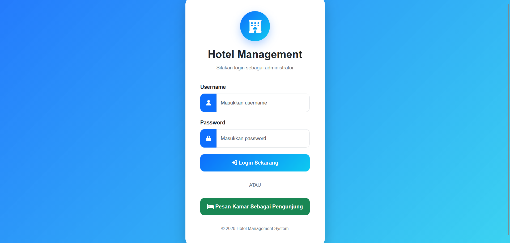
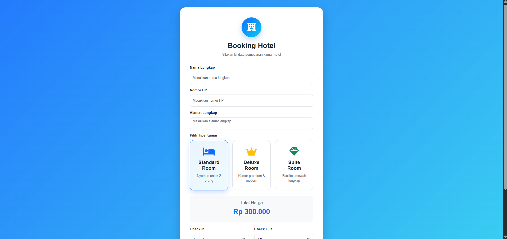
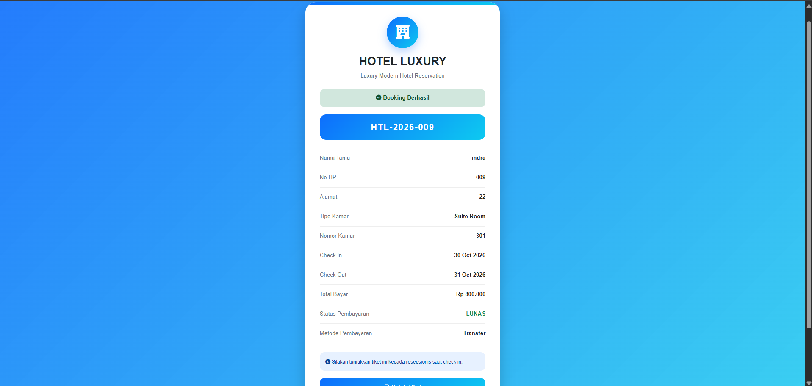
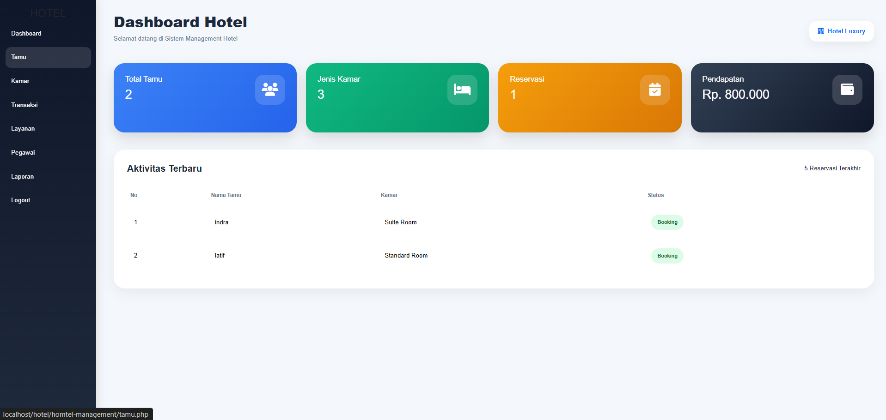
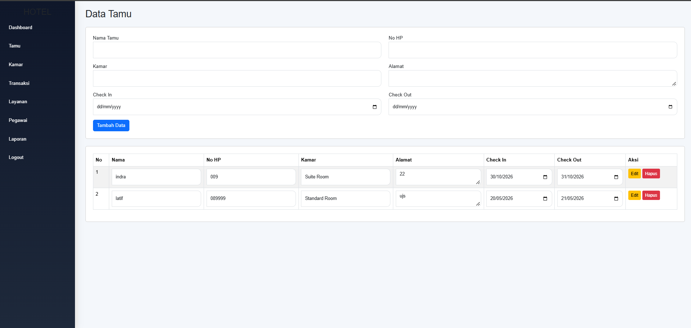
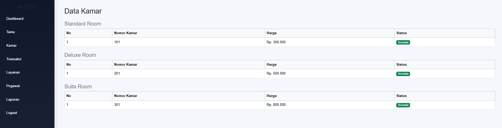
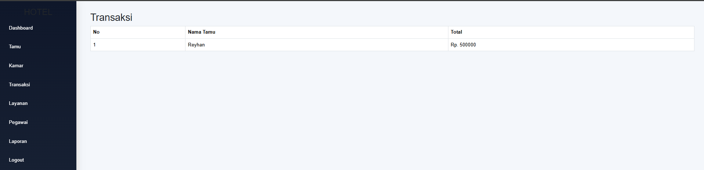
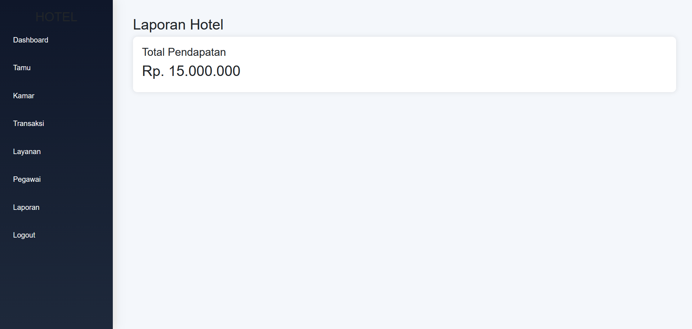

# Hotel Management System

[🇮🇩 Bahasa Indonesia](README.md) | 🇬🇧 English

A simple web-based hotel management application for recording guests, rooms, transactions, services, and staff. Built as a group project for the Web Programming Practicum using native PHP and MySQL.

The problem it addresses: small hotels often still handle bookings manually, so guest data, room prices, and payments get scattered easily. This app brings everything into one admin dashboard and also provides a public booking form that generates a ticket right away.

## Features

**Visitors**
- Room booking without logging in (Standard, Deluxe, Suite), with the total price calculated automatically from room type and stay dates
- Booking ticket with a reservation code, printable or savable as PDF

**Admin**
- Admin login with hashed passwords (bcrypt)
- Dashboard summary: total guests, room types, reservations, revenue, and the 5 latest activities
- Guest management (create, update, delete)
- Room list grouped by type with availability status
- Transactions, hotel services, staff, and revenue report

## Tech Stack

| Part | Technology |
|---|---|
| Backend | PHP 8 (mysqli, prepared statements) |
| Database | MySQL / MariaDB |
| Frontend | HTML, CSS, JavaScript, Bootstrap 5.3.3, Font Awesome 6.5.2 |
| Local server | XAMPP |

## Screenshots

| Admin login | Visitor booking |
|---|---|
|  |  |

| Booking ticket | Admin dashboard |
|---|---|
|  |  |

| Guests | Rooms |
|---|---|
|  |  |

| Transactions | Report |
|---|---|
|  |  |

## Project Structure

```
hotel-management-system/
├── src/                  # application code (place in htdocs)
│   ├── asset/            # css and js
│   ├── template/         # header, sidebar, footer, auth guard
│   ├── koneksi.php       # database connection config
│   ├── login.php, logout.php, index.php
│   ├── tamu.php, kamar.php, transaksi.php
│   ├── layanan.php, pegawai.php, laporan.php
│   └── pengunjung.php, tiket.php
├── database/
│   └── hotel_management.sql
├── docs/screenshots/
└── README.md
```

Note: file names are in Indonesian (`tamu` = guests, `kamar` = rooms, `layanan` = services, `pegawai` = staff, `laporan` = report, `pengunjung` = visitor, `tiket` = ticket).

## Getting Started

1. Install [XAMPP](https://www.apachefriends.org/) and start **Apache** and **MySQL**.
2. Clone this repo into the `htdocs` folder:
   ```bash
   cd C:/xampp/htdocs
   git clone https://github.com/indrwjyn/hotel-management-system.git
   ```
3. Open phpMyAdmin (`http://localhost/phpmyadmin`) and import `database/hotel_management.sql`. It creates the `hotel_management` database along with sample data.
4. Check `src/koneksi.php`. XAMPP defaults to user `root` with no password. Adjust it if yours differs.
5. Open `http://localhost/hotel-management-system/src/login.php`.

**Demo account:** username `admin`, password `admin123`

The visitor booking page is at `src/pengunjung.php`.

## Database Schema

Tables: `kamar`, `layanan`, `pegawai`, `tamu`, `reservasi`, `transaksi`, `users`.
Main relations: `reservasi` references `tamu` and `kamar`, while `transaksi` references `reservasi`.

## Limitations and Planned Improvements

This project was built for learning, so a few known issues are listed honestly here:

- Deletion still happens through GET links with no CSRF token
- Some output is not yet escaped with `htmlspecialchars`
- The `resepsionis` (receptionist) role exists in the database but cannot log in yet
- Room prices in `asset/js/script.js` are hardcoded instead of read from the database
- No booking date conflict check and no automatic room status update
- Code is still one file per page and not yet separated into an MVC structure

## Team

| Name | Role |
|---|---|
| Raden Bagus Indra Wijaya Nugraha | Backend and Database |
| Reyhan Surya Putra | Frontend and Backend |
| Akmal Zaidan Zidna Azizi | Frontend and Database |
| Intan Kartika Sari | Helper |

## License

Created for academic purposes.
