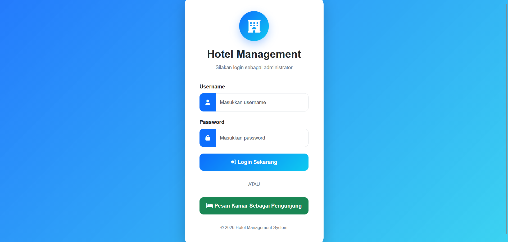
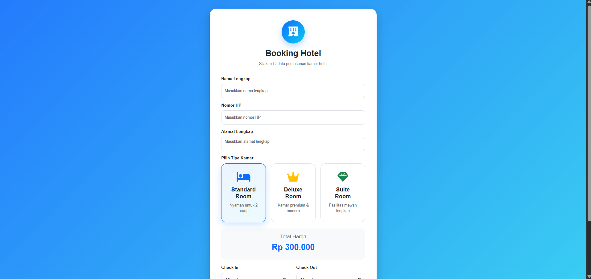
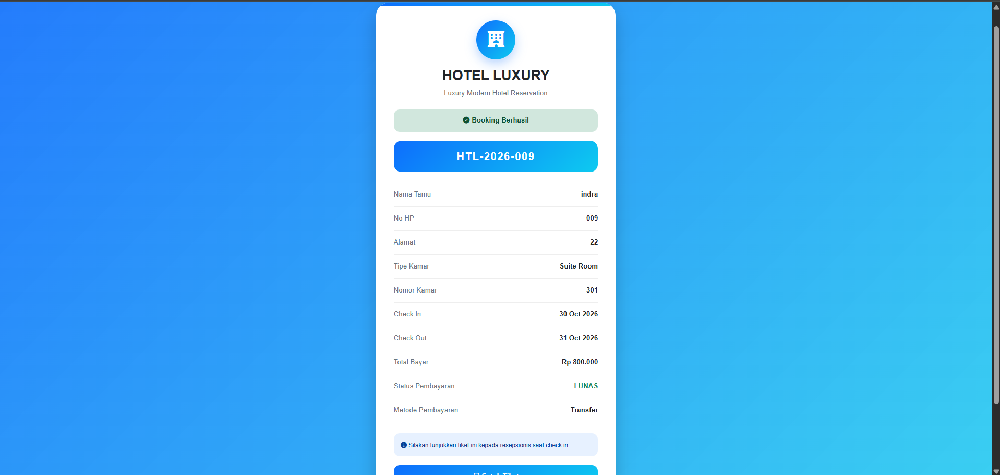
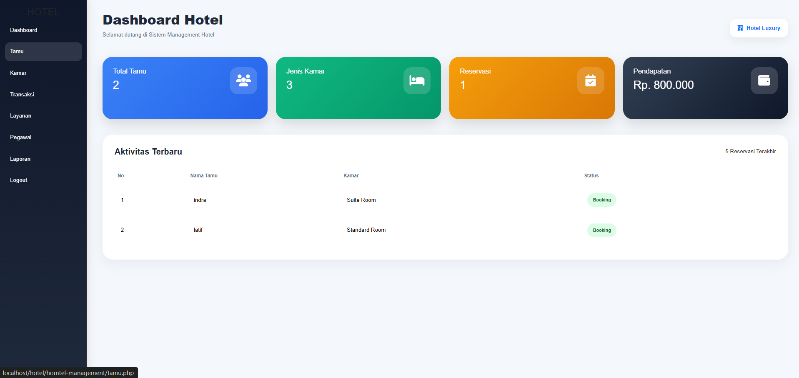
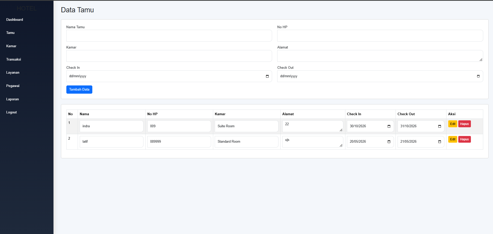
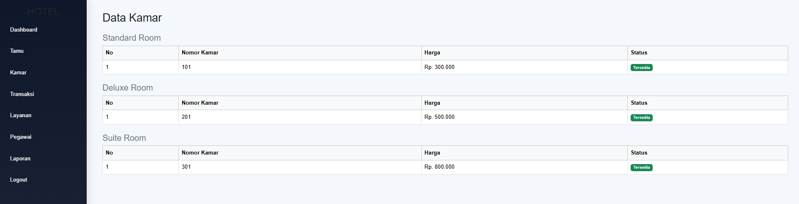
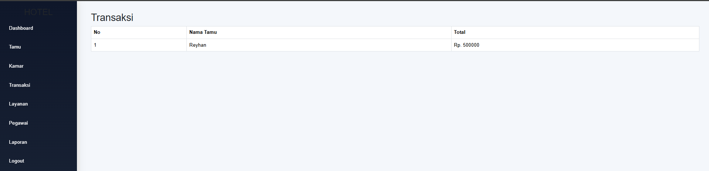
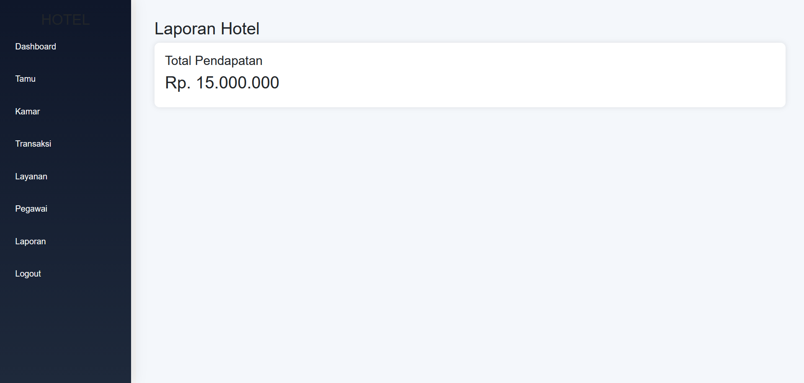

# Hotel Management System

🇮🇩 Bahasa Indonesia | [🇬🇧 English](README.en.md)

Aplikasi web manajemen hotel sederhana untuk membantu pencatatan tamu, kamar, transaksi, layanan, dan pegawai. Dibuat sebagai proyek Praktikum Pemrograman Web (kelompok) dengan PHP native dan MySQL.

Masalah yang ingin dijawab: pencatatan booking hotel kecil sering masih manual, sehingga data tamu, harga kamar, dan pembayaran gampang tercecer. Aplikasi ini memusatkannya dalam satu dashboard admin, sekaligus menyediakan form booking untuk pengunjung yang langsung menghasilkan tiket.

## Fitur

**Pengunjung**
- Booking kamar tanpa login (Standard, Deluxe, Suite) dengan total harga yang dihitung otomatis berdasarkan tipe kamar dan tanggal menginap
- Tiket booking dengan kode reservasi dan opsi cetak atau simpan sebagai PDF

**Admin**
- Login admin dengan password ter-hash (bcrypt)
- Dashboard ringkasan: total tamu, jenis kamar, reservasi, pendapatan, dan 5 aktivitas terbaru
- Data tamu (tambah, ubah, hapus)
- Data kamar per tipe beserta status ketersediaan
- Data transaksi, layanan hotel, pegawai, dan laporan pendapatan

## Teknologi

| Bagian | Teknologi |
|---|---|
| Backend | PHP 8 (mysqli, prepared statement) |
| Database | MySQL / MariaDB |
| Frontend | HTML, CSS, JavaScript, Bootstrap 5.3.3, Font Awesome 6.5.2 |
| Server lokal | XAMPP |

## Screenshot

| Login admin | Booking pengunjung |
|---|---|
|  |  |

| Tiket booking | Dashboard admin |
|---|---|
|  |  |

| Data tamu | Data kamar |
|---|---|
|  |  |

| Transaksi | Laporan |
|---|---|
|  |  |

## Struktur Proyek

```
hotel-management-system/
├── src/                  # kode aplikasi (taruh di htdocs)
│   ├── asset/            # css dan js
│   ├── template/         # header, sidebar, footer, auth guard
│   ├── koneksi.php       # konfigurasi koneksi database
│   ├── login.php, logout.php, index.php
│   ├── tamu.php, kamar.php, transaksi.php
│   ├── layanan.php, pegawai.php, laporan.php
│   └── pengunjung.php, tiket.php
├── database/
│   └── hotel_management.sql
├── docs/screenshots/
└── README.md
```

## Cara Menjalankan

1. Install [XAMPP](https://www.apachefriends.org/) lalu jalankan **Apache** dan **MySQL**.
2. Clone repo ini ke dalam folder `htdocs`:
   ```bash
   cd C:/xampp/htdocs
   git clone https://github.com/indrwjyn/hotel-management-system.git
   ```
3. Buka phpMyAdmin (`http://localhost/phpmyadmin`), lalu import `database/hotel_management.sql`. File ini sudah membuat database `hotel_management` beserta data contoh.
4. Cek `src/koneksi.php`. Bawaan XAMPP memakai user `root` tanpa password. Sesuaikan jika berbeda.
5. Buka `http://localhost/hotel-management-system/src/login.php`.

**Akun demo:** username `admin`, password `admin123`

Halaman booking pengunjung ada di `src/pengunjung.php`.

## Skema Database

Tabel: `kamar`, `layanan`, `pegawai`, `tamu`, `reservasi`, `transaksi`, `users`.
Relasi utama: `reservasi` mengacu ke `tamu` dan `kamar`, sedangkan `transaksi` mengacu ke `reservasi`.

## Keterbatasan dan Rencana Perbaikan

Proyek ini dibuat untuk pembelajaran, jadi ada beberapa hal yang sengaja dicatat jujur di sini:

- Penghapusan data masih lewat link GET, belum ada token CSRF
- Sebagian output belum di-escape dengan `htmlspecialchars`
- Role `resepsionis` sudah ada di database tetapi belum bisa login
- Harga kamar di `asset/js/script.js` masih ditulis langsung, belum diambil dari database
- Belum ada pengecekan bentrok tanggal booking dan perubahan status kamar otomatis
- Struktur kode masih satu file per halaman, belum dipisah ke pola MVC

## Tim

| Nama | Peran |
|---|---|
| Raden Bagus Indra Wijaya Nugraha | Backend dan Database |
| Reyhan Surya Putra | Frontend dan Backend |
| Akmal Zaidan Zidna Azizi | Frontend dan Database |
| Intan Kartika Sari | Helper |

## Lisensi

Dibuat untuk keperluan akademik.
